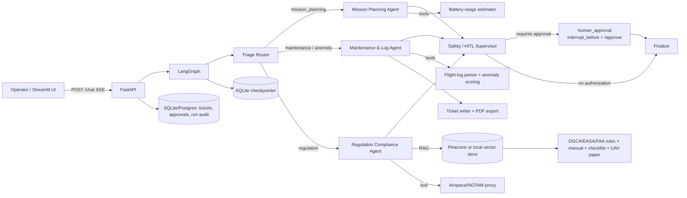

# Drone Ops Agent

Production-grade, multi-agent RAG application for UAS/drone fleet maintenance and mission readiness.

> **Safety notice:** This is an engineering demo for decision support. It is **not** certified for real-world flight operations. Any `TAKEOFF`/arm recommendation is gated by a **human-in-the-loop (HITL) approval** step — never treat this system as an autonomous authorizer.

## What it does

- **RAG over real drone-domain docs** (FAA Part 107, EASA Open Category, DGCA Drone Rules, a hexacopter flight manual, a maintenance checklist, and a hexacopter UAV paper PDF). Answers are grounded in retrieved passages and **must include citations** (source + section/page). If retrieval confidence is below threshold, the agent refuses to guess and issues safe guidance.
- **Multi-agent graph (LangGraph)** with explicit routing/handoffs: `triage → {mission_planning | maintenance | regulation | anomaly} → safety_supervisor → (human_approval if required) → finalize`.
- **Real tool functions** (not mocked): physics-based battery/range estimator, flight-log CSV parser + anomaly scoring, airspace/NOTAM proxy (real METAR + clearly labelled simulated NOTAMs), SQLite/Postgres ticket writer, PDF report exporter.
- **Production basics**: FastAPI (`/chat` SSE, `/approve`, `/approvals/pending`, `/logs`, `/tickets/{id}`, `/report/{id}`, `/health`), Pydantic validation, structured JSON logging, env-gated LangSmith tracing, retrieval eval dataset (20 Q/A) + harness, pytest suite, Docker + docker-compose, GitHub Actions CI.
- **Streamlit UI**: chat with streaming agent trace, citations, ticket table, and a visible **pending human approval** banner.

## Architecture



**Typed state & handoffs:** `backend/app/agents/state.py` defines the shared `AgentState` (TypedDict). Triage sets `classification`; specialists populate `answer`, `citations`, `recommended_action`, `tool_results`; the safety supervisor sets `requires_approval`/`approval_id` and routes to HITL or finalize.

**HITL (required):** if the output implies takeoff/arm authorization (e.g., `recommended_action` in `TAKEOFF|ARM` or authorization keywords), the safety node persists a `PENDING` approval record and the graph is compiled with `interrupt_before=["human_approval"]`. The run pauses; an operator decides via `POST /approve` (or the Streamlit banner), which resumes the graph and records the decision. Approval persistence/resume failures fail **safe** (authorization blocked / rejected).

## Stack

- Python 3.12, FastAPI, Pydantic v2
- LangGraph (primary) + LangChain utilities; OpenAI (pluggable) with an **honest offline fallback** when no key is set
- Embeddings: OpenAI `text-embedding-3-small` or local `sentence-transformers/all-MiniLM-L6-v2`
- Vector store: **Pinecone** (serverless, cosine) or **local JSON+numpy** (`VECTOR_BACKEND=auto`)
- Storage: SQLite by default; Postgres via `DATABASE_URL` (used in docker-compose)
- Streamlit UI, Docker/Compose, GitHub Actions, AWS App Runner config (`apprunner.yaml`)

## Repository layout

```
backend/app/
  agents/        graph.py, nodes.py, state.py, llm.py, prompts.py
  rag/           chunking.py, embeddings.py, vectorstore.py, ingest.py, retrieve.py
  tools/         battery.py, flight_logs.py, notam.py, ticket.py, report.py
  evals/         eval_dataset.json (20 Q/A), run_eval.py
  main.py        FastAPI endpoints, SSE chat, HITL approve
frontend/        streamlit_app.py
data/docs/       regulations + manual + checklist + pdf/hexacopter_uav_design_paper.pdf
tests/           pytest suite (graph transitions, tools, RAG chunking, NOTAM, SSE slim)
evals/           results.json (latest run)
docs/            demo.gif, screenshot_approval_banner.jpeg
```

## Setup (local, offline-capable)

```bash
python -m venv .venv
# Windows: .venv\Scripts\activate   |   macOS/Linux: source .venv/bin/activate
pip install -r requirements.txt

cp .env.example .env   # optional: add OPENAI_API_KEY / PINECONE_API_KEY for full mode

# Build the corpus + vector index (uses local embeddings if no OpenAI key)
python -m backend.app.rag.ingest --reset
```

## Run

**API (FastAPI):**
```bash
python -m uvicorn backend.app.main:app --host 127.0.0.1 --port 8000 --reload
# docs: http://127.0.0.1:8000/docs   health: http://127.0.0.1:8000/health
```

**UI (Streamlit):**
```bash
streamlit run frontend/streamlit_app.py
# UI: http://localhost:8501  (points to DRONEOPS_API, default http://127.0.0.1:8000)
```

**One command (Docker Compose):**
```bash
cp .env.example .env
docker compose up --build
# UI http://localhost:8501  |  API http://localhost:8000
```
> Compose runs Postgres for the API; the image bakes the corpus+embeddings for a fast offline cold start. Docker must be installed.

## API

| Method | Path | Purpose |
|---|---|---|
| `POST` | `/chat` | Run the agent; **Server-Sent Events** stream (`run_started`, `node`, `approval_required`/`final`, `error`). Body: `{"query": "...", "log_file?": "...", "lat?": ..., "lon?": ...}` |
| `POST` | `/approve` | HITL decision; resumes an interrupted run. Body: `{"approval_id": "...", "approved": true/false, "decided_by": "..."}` |
| `GET` | `/approvals/pending` | Pending HITL approvals |
| `GET` | `/logs` | Tickets, approvals, recent runs, available flight-log CSVs |
| `GET` | `/tickets/{ticket_id}` | Ticket detail |
| `POST` | `/report/{ticket_id}` | Export ticket as `application/pdf` |
| `GET` | `/health` | Liveness + provider/backend status |

## Eval & tests

```bash
python -m pytest -q                 # tool + graph-transition tests (no live LLM required)
python -m backend.app.evals.run_eval  # 20 Q/A retrieval eval -> evals/results.json
```

Latest checked-in eval (`evals/results.json`, local embeddings, `top_k=4`, threshold `0.33`): **n=20, hit@1=0.90, hit@k=1.00, confident_rate=1.00, mean_top_score=0.5639**. The harness is retrieval-focused and offline-safe; add an LLM-as-judge only when `OPENAI_API_KEY` is configured (env-gated, consistent with LangSmith tracing).

## LangSmith tracing

Tracing is **env-gated** and off by default. To enable:
```env
LANGSMITH_TRACING=true
LANGSMITH_API_KEY=...
LANGSMITH_PROJECT=drone-ops-agent
```
`/health` reports `langsmith_tracing`. Capture and commit a trace screenshot for your demo (not included here, since tracing requires a live key/project).

## Demo assets

- `docs/demo.gif` — UI/demo capture
- `docs/screenshot_approval_banner.jpeg` — HITL pending-approval banner

## Real vs simulated (honest)

| Component | Status | Notes |
|---|---|---|
| RAG corpus (DGCA/EASA/FAA, manual, checklist, UAV paper PDF) | **Real documents/content in-repo** | Ingested with metadata filters (`doc_type`, `section/page`, `regulation`). |
| Chunking, embeddings, vector search, citations | **Real** | Recursive chunking w/ overlap; Pinecone or local JSON+cosine. |
| Battery-range estimator | **Real** (physics model) | C-rate, voltage sag, wind margin, reserve; deterministic. |
| Flight-log parser + anomaly scoring | **Real** (deterministic) | CSV schema, imbalance/vibration/sag/temp rules, verdict, ticket creation. |
| METAR/TAF (aviationweather.gov) | **Real, no key**, with cache | Graceful offline mode. |
| NOTAM feed | **SIMULATED** (`notam_source: "simulated"`) | FAA NOTAM Search needs registered credentials; responses are clearly flagged. **Do not treat as operational.** Wire a keyed NOTAM/TFR source before production. |
| LLM answers | **Real (OpenAI) or labelled offline fallback** | Without `OPENAI_API_KEY`, responses are extractive and explicitly marked `[OFFLINE MODE]`. |
| Sample flight log / generated paper asset | **Sample/synthetic corpus assets** | For reproducible demo/eval; replace with your real fleet data. |

## Limitations

- Regulation answers are grounded in the bundled excerpts, not a live, complete legal database — verify with the authoritative aviation authority/portal (FAA LAANC/1800wxbrief, EASA, DGCA Digital Sky) before any real flight.
- NOTAM/TFR layer is simulated until a keyed provider is integrated.
- Triage falls back to keyword routing offline; mission-planning battery overrides are parsed heuristically from text.
- The safety model gates obvious authorization phrases/actions, but it is not a certified safety case. HITL is mandatory, not optional.
- Local vector store/embeddings are for dev/demo scale; use Pinecone + managed DB for production workloads.
- Never commit secrets — keep keys in `.env` (see `.env.example`).

## What I learned about agentic failure modes

Building a safety-relevant multi-agent system taught me that most failures are *coordination and grounding* failures, not model cleverness failures. First, **ungrounded confidence** is the default risk: a fluent answer can be wrong, so I gate regulation responses on retrieval confidence and refuse-with-safe-guidance rather than guessing, and I require citations on every grounded claim. Second, **tool and state failures must fail safe**: if a log parser, retriever, or approval record errors, the graph returns `HOLD`/blocks authorization instead of proceeding on partial truth. Third, **HITL is a control-flow guarantee, not a UI hint** — I enforce it with LangGraph `interrupt_before`, persisted approval state, and resume, so “takeoff authorized” cannot be emitted without a recorded human decision. Fourth, **routing errors compound**: a misrouted query reaches the wrong evidence and tools, so typed state and explicit handoffs matter. Finally, **observability is part of correctness** — structured logs, per-node traces, and env-gated LangSmith/evals make failure modes debuggable instead of mysterious.
